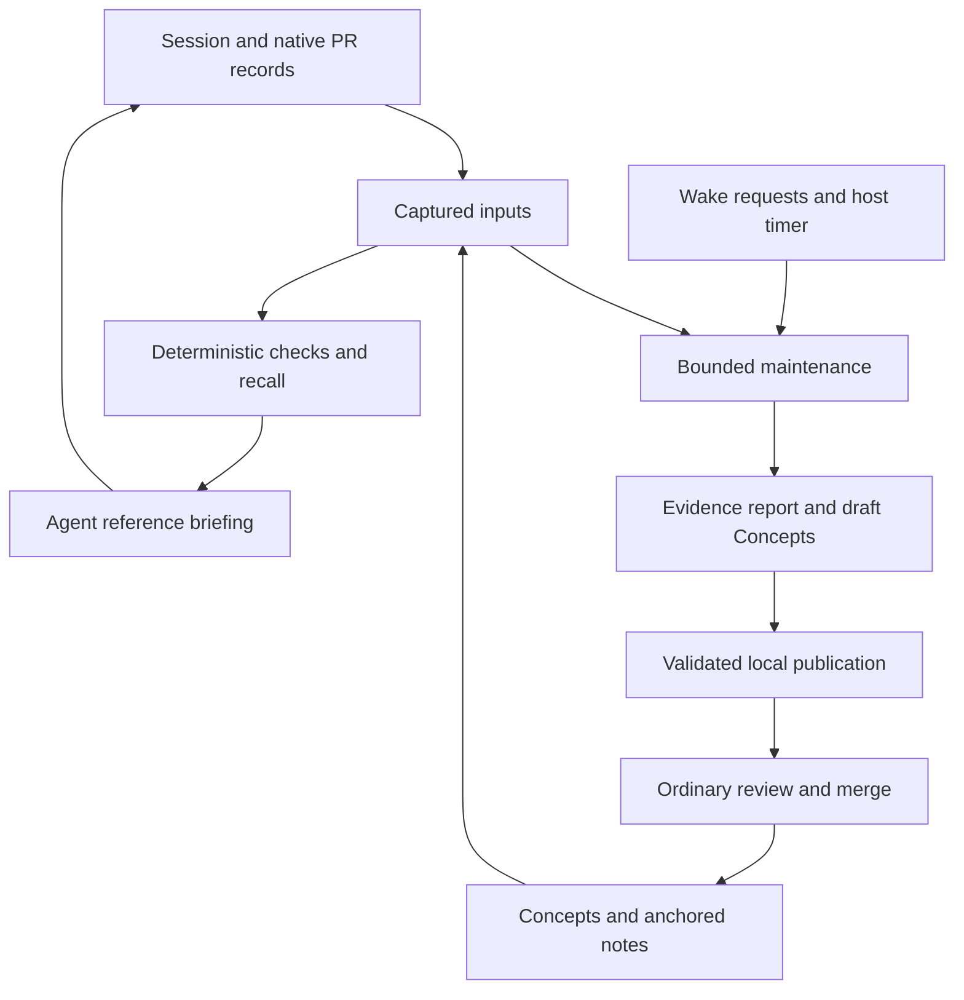

# Maintained agent memory

Maintained memory closes the repository-agent learning loop: capture useful observations, retain their evidence, supply relevant knowledge to later work, detect changed support, and prepare reviewable improvements from completed work. It combines validated recall, bounded Node maintenance, native outcome interpretation, an optional stdio model runner, and guarded local draft publication. Correctness checks and the retained historical pilot are documented below; the pilot establishes no productivity improvement.

Use [agent sessions and wake rules](agents.md#22-memory) for harness integration, [anchored notes](notes.md) for explicit source constraints, and [generated CLI help](cli.md) for exact command options. The design draws on [maintenance-oriented agent memory](https://polylane.com/blog/how-to-build-a-memory-system-for-proactive-agents/), while retaining this repository's Git-native evidence and authorization model.

## Scope and ownership

| Artifact       | Meaning and authority                                                 | Storage                                                        |
| -------------- | --------------------------------------------------------------------- | -------------------------------------------------------------- |
| Observation    | What a session reports learning; repetition grants no authority       | Signed `session.produced` records                              |
| Concept        | Authored reusable knowledge with declared evidence and lifecycle      | `.gitplus/knowledge/` source files                             |
| Anchored note  | Explicitly authored source constraint with signed lifecycle judgments | `refs/hub/note/*`                                              |
| Briefing       | Bounded reference context derived from eligible inputs                | Disposable derived artifact                                    |
| Input manifest | Exact views, captured heads, time, configuration, and versions        | Inspectable derivation and job artifacts                       |
| Check report   | Separate evidence findings and scoped semantic assessment             | Retained local report; published evidence report for proposals |
| Outcome        | One underlying native PR disposition and its source-history evidence  | Existing hub records and Git history                           |
| Proposal       | Suggested Concept changes awaiting normal review                      | Host-local job state and optional local draft branch           |



The portable core owns parsing, evidence identities, provenance, eligibility, selection, rendering, and repository operations. The Node host owns scheduling, durable jobs, model invocation, resource ceilings, and credential access. A model receives bounded evidence and returns typed suggestions; it does not select commands, mutable refs, credentials, or publication policy.

V1 semantic curation targets authored Concepts and native hub PR outcomes. Raw session notes remain observations; anchored notes retain explicit lifecycle actions. Deterministic checking requires no model credentials, vendor SDK, retrieval service, or live infrastructure verifier. Provider discussion import, typed direct PR citations, Cloudflare/browser background scheduling, embeddings, multi-repository knowledge graphs, full replicated transcripts, and a new interactive memory UI are deferred. Autonomous merging, policy edits, note confirmation, promotion, and retirement require a separate reviewed scope decision.

## Invariants

These contracts govern capture, recall, maintenance, and publication. Their identifiers remain stable for regression references.

| ID     | Requirement                                                                                                   |
| ------ | ------------------------------------------------------------------------------------------------------------- |
| INV-01 | Every automatically recalled session observation has accepted immutable source-record support.                |
| INV-02 | Identical manifest and object bytes produce identical deterministic results and rendered bytes.               |
| INV-03 | Derivation walks captured object IDs; it does not silently resolve newer mutable heads halfway through.       |
| INV-04 | Memory is reference data and never grants instruction or capability authority.                                |
| INV-05 | Observation persistence succeeds before a derived briefing can claim that observation exists.                 |
| INV-06 | Accepted tombstones and applicable revocations exclude support before ranking and rendering.                  |
| INV-07 | Missing, unavailable, changed, stale, and disproven are distinct conditions.                                  |
| INV-08 | A partial traversal never reports complete coverage.                                                          |
| INV-09 | Budgeting includes framing and provenance; a selected claim retains its required support.                     |
| INV-10 | Publication uses an expectation captured before derivation and never silently refreshes that expectation.     |
| INV-11 | Current-use validation is required even when a stored projection has a matching unsigned stamp.               |
| INV-12 | Maintenance does not automatically change note baselines, instructions, policy, or protected source branches. |

## Learning and recall

The installed session hook records an explicit learning file, scoped to the repository checkout and harness session. It may record a null observation. It never infers that a branch's commits were authored by the agent. Harnesses may provide explicit comma-separated `CHR33S_GIT_COMMITS`, `CHR33S_GIT_BRANCH`, and `CHR33S_GIT_PULLS` output links, and `CHR33S_GIT_USAGE` as JSON with `inputTokens` and `outputTokens`. Missing usage remains unknown. Commit links must identify available commits; native PR links must identify available native PRs.

A private, atomically published output handoff retains the signed event, its immutable commit identity, and its original destination expectation before append. Retrying reconciles the accepted record before repeating a side effect. An intervening append is preserved through a DAG join. Accepted observations survive failure to rebuild memory. Stop results distinguish `not-recorded`, `recorded`, and `recorded-projection-unavailable`; an incomplete handoff retains its session identity for retry. Recovery does not restore a redacted payload from retained local bytes.

Startup memory is derived from current inputs and supplied as reference data. It grants neither instruction authority nor capabilities. `SessionOpened.context.instructions` continues to identify standing instructions. `CHR33S_GIT_STARTUP_MEMORY=false` disables this optional context enhancement independently of session capture and maintenance.

The hook retains a local `briefing.<harness-digest>.json` artifact containing the full input manifest, audit digest, projection fingerprint, and a `git+context-render/v1` commitment over the startup-memory segment. This records that segment only; it makes no claim about the rest of the model invocation. Repeated prompts do not repeat the briefing. They revalidate delivered support against all currently eligible evidence, including entries omitted by the current render budget, and surface an invalidation diagnostic when support is lost. Version-2 artifacts preserve the original delivered manifest/render commitment separately from the current evaluation and its remaining support watch. Only current text is retained for use; old text is never an automatic-use fallback.

A shared evaluator checks session citations and directly recalled observations against captured session heads, repository binding, signatures, authorization, and accepted tombstones. Frequency counts distinct eligible sessions. Recency uses the latest eligible production-event ID, including activity from resumed sessions. An uncited authored Concept remains eligible under the existing Concept rules; it is not thereby provenance-verified.

The default complete memory block is limited to 16,384 UTF-8 bytes, including its reference-data framing, provenance, coverage diagnostics, and fingerprint stamp. Oversized candidates are skipped without blocking smaller ones. Mandatory framing that cannot fit returns `Invalid` with reason `budget-too-small`. Task recall continues to search the full eligible Concept corpus under its separate budget.

Memory persistence takes a prepared derivation, including the memory-ref expectation captured before discovery. It detects observed source/trust/policy movement and distinguishes `superseded-input` from a destination `conflict`. Equivalent evaluations before the next temporal boundary retain their projection fingerprint and render bytes, despite differing audit manifests, and need no cache commit. Ref enumeration and the later CAS do not constitute an atomic snapshot across all refs. Every automatic exposure derives current data again.

## Inputs and deterministic derivation

Capture the destination memory-ref expectation before collecting sources. Resolve participating refs once, then walk their immutable heads. [MemoryInput.ts](../src/hub/MemoryInput.ts) defines the versioned manifest retained in full by derivation and job artifacts:

| Field                                          | Contract                                                                   |
| ---------------------------------------------- | -------------------------------------------------------------------------- |
| `version`                                      | Versioned internal manifest schema                                         |
| `repository`                                   | Repository identity; missing identity is explicitly represented            |
| `view`                                         | Existing `{ base, tree }` shape; `tree` identifies effective source bytes  |
| `sourceRef` / `sourceHead`                     | Named committed source selection, when applicable                          |
| `sessionHeads`                                 | Ref/OID pairs actually used for session observation/citation evaluation    |
| `noteHeads` / `outcomeHeads` / `proposalHeads` | Relevant ref/OID pairs when those inputs participate                       |
| `genesis` / `trustHead` / `policyHead`         | Identities used for authorization and eligibility                          |
| `evaluatedAt`                                  | One explicit ISO 8601 instant with offset                                  |
| `versions`                                     | Parser, checker, projection, and selection versions                        |
| `configurationDigest` / `limits`               | Identity and values of effective bounded behavior                          |
| `expectedMemoryHead`                           | Destination expectation captured before derivation, including absent       |
| `coverage`                                     | Complete/partial state, known omitted counts, and continuation information |

The audit digest uses canonical JSON with UTF-8 byte-ordered keys, including nested and numeric-looking keys; array order remains significant. A digest alone does not replace the inspectable manifest. Missing identities or cross-ref dependencies remain explicitly absent or unavailable. Ref enumeration is an explicit input view, not an atomic snapshot of every ref.

Collection, provenance/eligibility assessment, selection, rendering, and persistence remain separate operations. Derivation uses its explicit evaluation instant; it neither invokes a model nor accesses the live network, repeatedly samples a clock, or depends on host locale sorting. Keep provenance, dependency, temporal, external-source, retention, and optional semantic findings separate. Source drift requests revalidation; missing data and read failures do not establish falsehood or deletion. Offline external-source currency remains unknown.

Within the observation group, rank by distinct eligible supporting sessions descending, then latest eligible production-event ID descending, then byte-ordered identity. Repeated events in one session count once. Removed or revoked records contribute neither frequency nor recency. Bounded discovery reports partial coverage, omitted counts, and reachable continuation instead of claiming all recent activity was inspected. Select claims and their required support together; never truncate an identifier or discard provenance to meet the budget. Exclusion diagnostics must not repeat withdrawn text.

The separate `projectionFingerprint` captures immutable input identities, effective algorithm/configuration versions, eligibility/selection results, and the next temporal boundary. It excludes the destination expectation, job identity, and evaluation-time changes that alter no semantic result. Rendering uses that fingerprint so equivalent evaluations can be no-ops; the full audit manifest still records their different instants and expectations.

Persistence returns `written`, `unchanged`, `conflict`, `superseded-input`, or `no-anchor`; storage errors remain typed failures. It uses the original captured expectation and validates source/trust/policy inputs before CAS. A source change after that check can still precede destination CAS, so written artifacts retain their captured view and current-use validation remains required. Missing genesis yields `no-anchor`. An unsigned Git stamp is insufficient to authorize reuse, and historical `Memory.read()` text is never a fallback when current derivation fails.

## Deterministic maintenance

A worker uses a private `maintenance/` directory inside the bare repository, beside its objects and refs. These files are operational state, outside replicated Git refs:

- `config.json`: optional, operator-owned configuration.
- `requests/`: durably enqueued notifications, identified by canonical input digest.
- `jobs/`: versioned manifests, selection plans, completed results, and continuation cursors.
- `history.json`: previous check metadata used for scheduling, never knowledge authority.
- `worker.lock`: informational owner metadata for a local OS-owned lease, separate from wake's cursor lock.

Example operator configuration:

```json
{
  "version": 1,
  "sourceRef": "refs/heads/main",
  "limits": {
    "concepts": 25,
    "outcomes": 5,
    "timeoutMs": 120000,
    "evidenceBytes": 1048576
  }
}
```

The defaults shown bound work per pass; they are configuration choices, not measured capacity claims. CLI limits may lower operator ceilings. A resumed job uses its saved evaluation instant, input heads, selection history, and limits; incompatible overrides require a new evaluation.

```sh
git+ knowledge maintain request --root /srv/git --repo project --trigger manual --json

git+ knowledge maintain run --root /srv/git --repo project \
  --ref refs/heads/main --at 2026-10-28T09:00:00+07:00 --json

git+ knowledge maintain run --root /srv/git --repo project --job <job-id> --json

git+ knowledge maintain show --root /srv/git --repo project --job <job-id> --json
```

A host timer should invoke `run` directly with an explicit evaluation instant, even when no refs have moved. Calling `wake` on an unchanged repository does not perform an age-based knowledge check. Scheduling is operator-owned; no timer is installed by these commands. Node hosts can use `MaintenanceTimer.node.ts`: it calls the worker directly on an Effect schedule, supplies a fresh clock for each new evaluation, resumes partial jobs, and exposes results to the host callback. Operational errors reach the host supervisor.

`request --trigger wake` validates the existing `CHR33S_GIT_EVENT`, `CHR33S_GIT_REF`, `CHR33S_GIT_COMMIT`, and `CHR33S_GIT_REPO` hints and rereads the retained record and its reachable ref. Supported triggers are `session.produced`, `decision.resolved`, `task.closed`, `pr.merged`, `pr.closed`, and `event.redacted`. Maintenance bookkeeping does not start another curation cycle. The wake dispatcher walks hub refs; source-only changes need the direct timer or a separately authorized host notification. Notification data is never executable argv. Wake configuration remains operator-owned and uses the dispatcher's existing exact or single-asterisk prefix rules.

Selection considers changed dependencies, unchecked Concepts, expired Concepts, the least recently checked Concepts, and unprocessed native PR outcomes linked to captured outputs. A reserved quota prevents changes from monopolizing a pass. Single-item passes rotate among aging, unchecked, and changed work using a saved selection round. Checks walk immutable captured heads, report each evidence dimension independently, and explicitly label semantics `not-assessed`. No Concept-supplied command or URL is executed.

Reports retain the job/evaluation identity, full input manifest, selection reasons, examined evidence, separate check dimensions, proposed changes, exclusions, coverage, timings, and retry information. Job states are `requested`, `running`, `reported`, `partial`, `retryable-failure`, and `proposed`; partial jobs resume with saved continuation. Semantic assessments are `not-assessed`, `supported-within-scope`, `contradicted-within-scope`, or `inconclusive`, with examined evidence and scope. They neither replace deterministic evidence findings nor promote knowledge.

Each completed Concept result is checkpointed. Cancellation saves a partial job and releases the lock. Timeout and byte limits retain completed results and leave unfinished work pending. Dry runs perform deterministic checking without journal/cache/proposal writes, model calls, or request acknowledgement. `--dry-run` and `--propose` are mutually exclusive.

Without a configured runner, `--propose` returns `no-proposal` after deterministic checking and creates neither a proposal branch nor a maintenance session. Incomplete outcomes remain pending. A timed-out publication is `pending`, with retained side-effect checkpoints; it is never reported as having no changes.

## Outcome assistance and draft publication

Native outcome checking joins accepted PR records to explicitly captured agent output commits, verifies their relationship to accepted source history, and retains reviews, actor classification, dismissals, scope, contradictions, and missing evidence. A rewritten head without sufficient original linkage remains insufficient. One underlying repository/PR identity is one independent example regardless of retries or repeated summaries. Unexplained closure teaches no negative preference. Actor classification comes from operator configuration; bot and unknown actors do not establish human preference.

An outcome report binds repository/PR identity to the original agent session and reliable output links, original proposed head, accepted head and merge commit when available, review/comment/decision record IDs, source-history acceptance facts, actor classification, affected paths, and contradictions. An accepted PR projection and actual history relationship are both required; a signed object or unverified `pr.merged` assertion alone is insufficient. Its independent outcome key is repository/PR identity. Its evaluation key additionally binds evidence heads, trust, configuration, versions, and evaluation window; reevaluation cannot become another independent example.

Optional configuration extends the example above:

```json
{
  "version": 1,
  "sourceRef": "refs/heads/main",
  "actors": [{ "fingerprint": "SHA256:<reviewer-fingerprint>", "kind": "human" }],
  "runner": {
    "id": "local-curator",
    "version": "1",
    "executable": "/absolute/path/to/curator",
    "args": [],
    "timeoutMs": 30000
  },
  "publisher": { "key": "/private/path/to/publisher-key" },
  "conceptRoots": [".gitplus/knowledge/maintained/"]
}
```

The executable receives one bounded versioned JSON evidence request on stdin and returns the typed `Proposal.Output` object on stdout. It runs with a private temporary working directory, no shell, and an environment limited to PATH and LANG. The host does not pass Git credentials or the publisher key to it. This environment separation is not an OS sandbox: operators must trust the executable and its access to local files. Stderr, stdout, input bytes, runtime, and child cleanup are bounded. Invalid output retains deterministic reports and leaves assistance partial. Dry runs never invoke the runner. Removing `runner` disables assistance independently of capture and startup recall.

An ordinary run retains validated interpretation locally. Explicit `--propose` additionally requires a publisher key authorized for `source.push` and `hub.session`; it grants itself no capability. Model text cannot select arbitrary files or source commits. Host validation rejects missing draft status, unsupported claims/citations, instruction/policy paths, traversal, collisions, symlink ancestors, symlink files, and executable files. Human-decision claims need accepted human review evidence; repeated-pattern claims require distinct underlying outcomes.

A proposal is a local `refs/heads/agent-memory/<identity>` branch containing two commits: a retained evidence report, followed by host-rendered draft Concepts. The maintenance session has a signed null-note output for each raw source commit. Draft citations point to the earlier report-output record, whose source parent does not contain the draft; the final output is a separate attestation. Current branch policy, path ownership, capability checks, and required Session provenance apply before advancing either source ref. No merge, promotion, or retirement is automatic.

Generated Concepts must explicitly declare `status: draft`: the authored-Concept parser otherwise defaults an omitted lifecycle to stable. Direct PR OIDs are not accepted session citations. A report-output citation authenticates the recorder, without transitively verifying the report's interpretation or underlying PR evidence. Retain immutable PR/review/head IDs in the evidence report and generated body. Only ordinary human-authorized source review may promote a draft.

Publication allows configured Concept Markdown paths under `.gitplus/knowledge/` and the generated JSON evidence report under `.gitplus/knowledge/reports/`. Existing secret checks, path ownership, policy, and source/session capabilities still apply; `hub.note` alone grants no publisher authority. Remote push, PR creation, review, and merge remain explicit operations outside the maintenance worker.

Publication checkpoints follow this order:

1. Open or recover the maintenance session and prepare stable identities.
2. Create the report commit with its `Session:` trailer and policy-required signatures.
3. Append its accepted `session.produced` output with `note: null`, then make the report reachable under the captured proposal-ref expectation.
4. Create the draft Concept commit, citing that earlier report-output record.
5. Append a separate accepted null-note output for the final commit, validate policy, advance the proposal ref with CAS, and mark completion.

Retain unfinished report bytes in durable job state until Git reachability is established. Reconcile completed steps before retrying; an object write or session append alone does not mean the proposal completed. A ref conflict never authorizes refreshing an old expectation or repeating the model interpretation.

Interpretation caching and proposal identity exclude irrelevant clock/job/history changes. Equivalent attempts revalidate evidence and reuse the local branch. The manifest captures destination expectations before derivation; source movement returns `superseded-input`, and competing destination movement returns `conflict`. Publication checkpoints reconcile prior accepted records before replay and do not restore redacted payloads. Resume with the original `--job ... --propose`; incompatible operator configuration requires a new evaluation.

JSON output is one versioned result on stdout; diagnostics use stderr. Run statuses are 0 for completion, 2 for partial work, 3 for superseded inputs, 4 for operational failure, and 1 for invalid configuration. `show` succeeds when it reads the artifact, including a failed job. Unknown artifact versions are refused rather than guessed.

## Recovery, compatibility, and rollback

| Situation                               | Required result                                                      |
| --------------------------------------- | -------------------------------------------------------------------- |
| Duplicate wake event                    | Reuse its durable request identity; no duplicate underlying outcome  |
| Crash after source event persistence    | Recover the accepted event; do not duplicate the handoff             |
| Crash after enqueue                     | Pending work remains discoverable                                    |
| Crash after report persistence          | Reuse report and resume the incomplete publication step              |
| Model runner absent                     | Complete deterministic checks; semantic results remain not assessed  |
| Model timeout or invalid output         | Preserve deterministic results; report the assisted part incomplete  |
| Evidence missing/offline                | Preserve unknown/unavailable and schedule eligible retry             |
| Source inputs move during work          | Superseded input or new derivation; no silent relabeling             |
| Destination ref moves                   | Conflict, or unchanged only for equivalent validated content         |
| No new knowledge or unchanged rendering | No redundant knowledge/projection commit                             |
| Budget exhausted                        | Explicit partial coverage, durable cursor, no loss of completed work |
| No current safe briefing                | Bounded diagnostic; no fallback to historical unvalidated prose      |

Source-observation persistence, derived-cache publication, report persistence, and proposal publication are separate outcomes. A later evaluation may change input/time identity without increasing independent PR support. Versioned reports and proposal artifacts refuse unsupported versions rather than guessing their meaning.

Startup recall, maintenance scheduling, and model assistance are independently controlled. To roll back, disable the new hooks and host jobs, remove the optional runner configuration, and continue ordinary session/note workflows. Retain source evidence and inspect or remove local proposal branches with normal Git operations. Rollback does not rewrite accepted session history. Stricter recall may exclude unverifiable old observations while historical inspection remains available. Replicas can lag; neither redaction nor rollback can erase prior model exposure or guarantee deletion from uncontrolled clones.

## Verification

Behavioral tests currently cover handoff replay and concurrent appends, independent harness sessions, recovery after cache failure, installed-hook delivery, memory budgets and resumed-session recency, source/destination races, redaction before and after collection, equivalent-time no-ops, quiet-day expiry, dry runs, request deduplication, bounded continuation, fairness, timeout, and interruption checkpoints. Main's anchored-note lifecycle, audit, API, and redaction paths are retained alongside trace redaction.

Additional tests cover native outcome linkage, typed assistance, model timeout/oversized-output cleanup, guarded draft publication, policy-required source attestations, acyclic citations, publication timeout/recovery, filesystem CAS races, and strict stock-Git fsck/fetch/read interoperability. The acceptance mapping and historical comparison below retain their distinct correctness and empirical conclusions.

Capture and maintenance leases reserve one stable loopback TCP port per canonical local lock path. The OS releases the lease on process death; a subprocess SIGKILL test verifies recovery with retained checkpoints and stale owner metadata. The metadata file is informational and is safely overwritten by the next lease owner. Hash collisions or another local service on the selected port cause retryable contention, never concurrent owners. These leases coordinate one machine; proposal CAS remains required between replicas. Missing/offline evidence remains unavailable or unknown. Semantic truth is scoped to examined evidence. Replicas can lag, a running context cannot erase bytes it has already received, and exclusion from future recall does not promise erasure from historical or uncontrolled copies.

## Acceptance audit

The stable acceptance IDs below map to executable behavior checks. This is a correctness audit, separate from the historical model comparison.

| Spec cases                   | Evidence                                                                                                                                                                                                                                                    |
| ---------------------------- | ----------------------------------------------------------------------------------------------------------------------------------------------------------------------------------------------------------------------------------------------------------- |
| AT-01–03                     | `cli/session.test.ts`: cache-failure recovery through the installed next-session hook, exact retained output identity, overlapping harness sessions, one briefing per active session.                                                                       |
| AT-04                        | `knowledge/Provenance.test.ts`: an appended live session cannot change the captured manifest's plan or evidence; `hub/Memory.test.ts` also verifies pinned session walks.                                                                                   |
| AT-05                        | `knowledge/Inputs.node.test.ts`: byte-identical plan, checks, and outcomes in two processes with different clocks, locales, and timezones.                                                                                                                  |
| AT-06                        | `knowledge/Provenance.test.ts`: accepted, foreign, unreachable, unsigned, revoked, and missing-trust support; `hub/Memory.test.ts`: direct recall excludes ungranted/unjudged observations.                                                                 |
| AT-07–10                     | `hub/Memory.test.ts`: resumed-session recency, bounded session coverage, tombstones before GC, independent surviving support.                                                                                                                               |
| AT-11                        | `hub/Memory.test.ts`: instruction-like learning remains reference data and changes neither trust nor policy.                                                                                                                                                |
| AT-12–13                     | `hub/Memory.test.ts`: exact UTF-8 ceilings, oversized-entry skipping, mandatory framing failure; `knowledge/Recall.test.ts`: atomic support-group omission.                                                                                                 |
| AT-14–15                     | `hub/Memory.test.ts`: retained destination expectations reject obsolete writers; observed session/source movement returns supersession.                                                                                                                     |
| AT-16                        | `cli/Briefing.node.test.ts`: source, trust, tombstone, and deadline changes replace retained automatic-use bytes while the memory ref remains unchanged.                                                                                                    |
| AT-17                        | `knowledge/Maintenance.node.test.ts`: direct scheduled passes check quiet refs after a deadline, using a controlled clock.                                                                                                                                  |
| AT-18                        | `knowledge/Maintenance.node.test.ts`: durable deduplication, continuation, and a real SIGKILL followed by same-job report recovery; `host/LocalLease.node.test.ts`: SIGKILL and checkpoint recovery; publisher tests reconcile partial output side effects. |
| AT-19–20                     | `knowledge/Maintenance.node.test.ts`: aging quota under continuous change, rotating one-item passes, deterministic model-free completion.                                                                                                                   |
| AT-21                        | `knowledge/Check.test.ts`: changed, missing, unavailable, and unknown evidence remain independent findings; maintenance preserves those deterministic check reports.                                                                                        |
| AT-22–24                     | `knowledge/Outcomes.test.ts`: one underlying PR per example, no preference from unexplained closure, bot/unknown classifications remain explicit.                                                                                                           |
| AT-25–27                     | `knowledge/Proposal.test.ts`: raw PR citations, absent draft status, instructions/policy/traversal, unsafe tree entries, and unrelated scope/evidence are rejected.                                                                                         |
| AT-28                        | `knowledge/Publisher.test.ts`: checkpoint failures across report and final-output publication; `knowledge/Assistance.node.test.ts`: pass timeout retains publication checkpoints for resume.                                                                |
| AT-29                        | `hub/Note.test.ts` and existing note CLI tests retain read-only repeated audit and explicit baseline confirmation.                                                                                                                                          |
| AT-30                        | `hub/Memory.test.ts`: later equivalent evaluations retain render/fingerprint and do not write another cache commit; `knowledge/Assistance.node.test.ts`: interpretation and proposal history reuse.                                                         |
| AT-31, AT-33                 | `knowledge/Publisher.test.ts`: policy-required output attestations, acyclic report citation, null observations, generated drafts absent from automatic recall.                                                                                              |
| AT-32                        | `hub/Memory.test.ts`: source movement between validation and CAS leaves the stored artifact pinned and the next exposure rederives current data.                                                                                                            |
| AT-34                        | `knowledge/Assistance.node.test.ts`: empty validated output does not read a publisher key or create a session/branch; deterministic mode has the same no-proposal behavior.                                                                                 |
| Stock Git and filesystem CAS | `knowledge/Publisher.interop.test.ts`: strict fsck, ordinary fetch/read of proposal and supporting refs, destination CAS conflict, and source supersession through the Node adapter.                                                                        |

The final 2026-10-29 repository-wide run used pinned Git 2.55.0 and passed 204 files and 2,298 tests, including strict fsck/fetch interoperability, workerd, and installed Chromium browser suites. Eleven Linux-only filesystem tests were skipped on macOS. Formatting, lint, generated CLI documentation, repository and evaluation-harness TypeScript checks, the SEA build, and executable maintenance help checks passed. The final named lease-operation tracing change also passed its 23-test focused run. Focused regressions also cover full retained-report equivalence, UTF-8 canonical ordering, authorization availability, and invalidation of previously delivered support after budget selection changes.

## Fixed historical comparison

[evaluation/proactive-memory/corpus.json](../evaluation/proactive-memory/corpus.json) pins five historical task scopes from three fix commits and their source snapshots. Actual Git object reads verified every named input path and its association with the reference fix. Cases cover repeated environment failures, rare absent-session diagnosis, a changed editor dependency, eventual upload reclamation, and portable gzip handling. Tombstoned/revoked support and dependency drift are additional controlled variants; they do not count as independent historical tasks.

Run all three conditions against identical task source, standing instructions, model, resource ceilings, and task budgets: pinned current-main behavior, integrated recall, and recall with reviewed curation. Use fresh conversations/checkouts, rotate condition order, keep reference fixes out of model inputs, and record exact configuration and artifact digests. Curated drafts must pass the ordinary reviewed lifecycle before automatic recall; the evaluation must not silently enable draft recall.

This is a retrospective replay of known fixes. Where a recorded lesson comes from that fix, report the training overlap: improvement demonstrates reuse rather than unseen-task generalization. A reviewer must assess supported diagnosis and executable task results against the retained criteria. Model self-report is not an acceptance result.

The retained [results](../evaluation/proactive-memory/results/2026-10-29/summary.json), [method](../evaluation/proactive-memory/results/2026-10-29/method.json), and [artifact archive](../evaluation/proactive-memory/results/2026-10-29/archive.json) record 24 stateless Claude Opus 5.5 invocations: eight task/variant combinations under three conditions. Five task scopes derive from three fix commits, with one repetition. Each invocation had the same 120-second, 64,000-input-token, 4,000-output-token budget and no tools or correction turns. The baseline manually supplies pinned main's existing cached `Memory.read` result; main's default hook supplies no memory and was not the baseline workflow tested.

| Condition          | Accepted results | Unsupported / stale lesson entries | Input / output tokens | Mean context read/derive | Mean completed response |
| ------------------ | ---------------- | ---------------------------------- | --------------------- | ------------------------ | ----------------------- |
| Main cached memory | 6/8              | 2 / 1                              | 133,465 / 10,544      | 1.86 ms                  | 15.53 s                 |
| Integrated recall  | 6/8              | 0 / 0                              | 136,593 / 8,660       | 6.77 ms                  | 13.42 s                 |
| Reviewed curation  | 6/8              | 0 / 0                              | 137,672 / 8,487       | 8.26 ms                  | 13.06 s                 |

All affected historical suites passed. Maintainer review rejected all six portable-gzip candidates for retained dead helpers and unchecked casts/`any`; acceptance is therefore 18/24. This maintainability endpoint was posthoc, and the model prompt did not include complete repository instructions. No answers were edited or retried. All source was supplied, so exploration was zero by design. Completed-response timing bounds supported-diagnosis timing; it does not measure first streamed diagnosis. CLI list-price estimates total $2.592374, not a verified bill. Combined maintenance/publication/fixture-curation preparation averaged 170.68 ms for the curated condition. Context timings exclude full hook startup. Controlled correction latency depends on sequential fixture preparation and establishes no production SLA.

Synthetic signed sessions and native PRs carry predetermined known-fix lessons. Fixture review uses the real draft publisher, then explicitly reviews stable fixture source outside the worker. It adds direct original-output citations and blob dependencies alongside report citations; report citations do not transitively validate PR evidence. Those explicit supports drive curated tombstone, compromise, and dependency-drift controls. This tests recall reuse and invalidation, not autonomous semantic-curator quality. The measured source snapshot is retained; later authorization/cursor/report guards, canonical UTF-8 ordering, and delivered-support fixes have separate correctness tests and no new timing claim. Equal acceptance, overlapping known fixes, five scopes from three commits, fixed source, and one repetition establish no general productivity or cost advantage. These results do not support expanding autonomous curation.

### Preparing and reporting a comparison

`tools/proactive-memory-evaluation.ts` prepares the fixed matrix and checks its retained results. It does not launch a model, spend provider credits, or infer review acceptance. The operator owns the model runner and condition-specific context generation.

```sh
node tools/proactive-memory-evaluation.ts prepare .git \
  evaluation/proactive-memory/corpus.json /private/evaluation-config.json \
  /private/evaluation-run

node tools/proactive-memory-evaluation.ts contexts \
  /private/evaluation-run /private/condition-contexts.json

node tools/proactive-memory-evaluation.ts report /private/evaluation-run
```

The corpus template leaves `comparisonConfiguration` unset; the retained run freezes its actual configuration in `plan.json` inside the archive. The version-1 configuration has one `runner` execution label (`id`, `version`, `model`, and JSON `settings`), one `budget` (`wallTimeMs`, `inputTokens`, `outputTokens`, `toolCalls`, and `corrections`), `repetitions`, a SHA-256 `standingInstructionsDigest`, and `runtimeDigests` for the three named conditions. The baseline must match the corpus's pinned main commit. Runtime identities must be immutable commit IDs or SHA-256 source-snapshot digests. Labels alone do not prove which model or code actually ran; retain host evidence of the invocation and runtime selection. The planner bounds the matrix to 10,000 slots and rotates condition order by task and repetition.

Preparation creates a fresh directory, saves the corpus and frozen plan, and reads only the selected historical files. Task packets contain symptoms and source snapshots; acceptance criteria and reference fixes stay in the operator's corpus artifact. `prepared.json` is written only after every source packet succeeds. The five-case corpus has eight task/variant combinations and 24 condition slots per repetition. A fixture-only smoke preparation read 165,183 source bytes and produced those 24 packets without invoking a model.

Before execution, generate actual recall contexts under each condition runtime. `contexts.json` input is `{ "version": 1, "plan": "sha256:...", "entries": [...] }`; each entry contains `slot`, `text`, JSON `provenance`, and nullable JSON `maintenance` evidence. Every planned slot must appear exactly once. Context text has the same 16,384-byte ceiling. The tool checks the retained task/configuration identities, freezes the complete `.input.json` payload for each slot, and records its exact byte digest. Changing contexts requires a new comparison. The runner receives only its selected frozen input in an isolated workspace; it must not access the corpus's withheld criteria/fixes or other runs. Invalidation and changed-dependency variants must exercise the actual runtime behavior, not just substitute a different text fixture.

Retain the runner's exact output bytes as `<slot-digest>.output.txt` and a typed `<slot-digest>.sample.json` artifact. A sample contains `version: 1`, `plan`, `slot`, positive `attempt`, exact SHA-256 `inputDigest` and nullable `outputDigest`, `state` (`completed`, `failed`, or `incomplete`), nullable `diagnostic`, and `metrics`. Every corpus metric must be present. A measured metric has `{ "state": "measured", "value": 123, "source": "host", "evidence": ["retained-trace.json"] }`; an unavailable metric has `{ "state": "unavailable", "reason": "Runner did not expose this telemetry" }`. Sources are `host`, `runner`, or `reviewer`. Accepted-task results require reviewer evidence and a binary 0/1 value. Unsupported/stale claims and reviewer-correction counts also require reviewer evidence. A model's own success assertion cannot establish task acceptance.

Reporting verifies the frozen plan and exact retained input/output bytes, rejects duplicate or foreign slots, and preserves failed/incomplete runs. Retain retry attempts separately: selecting an attempt does not add another independent slot. The report lists every missing slot, exposes per-metric availability, and computes paired differences only when both conditions supplied that metric for the same task/variant/repetition. Missing usage stays null. A complete set of recorded runs is labelled `recorded`; it is not a claim that tasks succeeded or that the empirical release gate passed. Review measured coverage, failures, confounds, and task acceptance before drawing a conclusion. Incomplete matrices return exit status 2.

Harness tests exercise missing pairs/telemetry, fixed budgets/order, mismatched configuration, retry duplication, unreviewed acceptance, payload changes, and unsupported artifact versions. Exact-byte tests additionally cover pooled Node Buffer views in render commitments, SSH signatures/fingerprints, and repository identity. This fixes the case where Buffer's view-preserving `slice()` allowed a digest to include bytes outside the supplied range.
